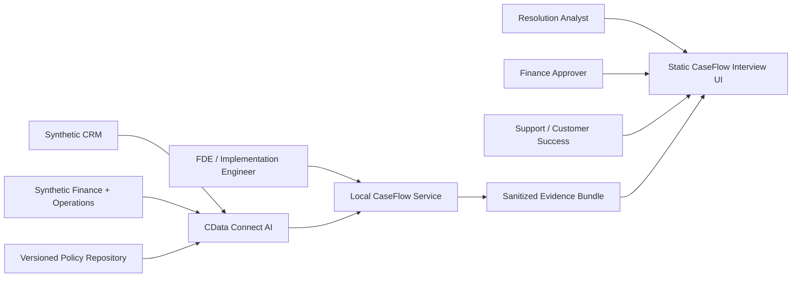

# System Context

## Trust boundaries

1. Public browser: synthetic replay only.
2. Local CaseFlow service: trusted development environment with ignored secrets.
3. CData cloud: authenticated connectivity boundary.
4. Source systems: synthetic accounts controlled by the owner.
5. Optional LLM provider: receives only the minimum normalized evidence needed for explanation drafting.

## Key invariant

No browser visitor can cause a CData query, model call, source write, or local command execution.
